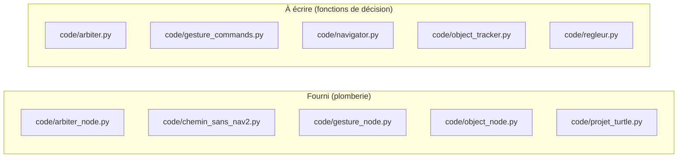
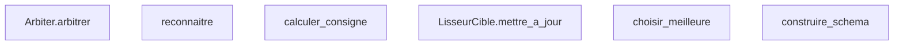

# Énoncé - Projet

## Objectif

Intégrer vision, geste et voix dans un pilotage arbitré du robot, avec Nav2 comme dorsale finale.

## Prérequis

- L'environnement conda ihr est actif, avec YOLO et MediaPipe installés.
- Un démon Ollama sert un modèle texte pour le régleur de paramètres.
- ROS_LOCALHOST_ONLY=1 et ROS_DOMAIN_ID sont définis avant tout lancement ROS2.

Vérifier l'environnement :

```
envs\ihr\python.exe -c "import rclpy, ultralytics, mediapipe"
```

## Architecture : fourni contre à écrire



## Fonctions à implémenter

| Fonction | Fichier | Indice | Tests |
| --- | --- | --- | --- |
| `Arbiter.arbitrer` | `code/arbiter.py` | ecarter les commandes perimees, puis retenir la plus prioritaire, la plus recente en cas d'egalite | `test_priorite_plus_haute_gagne_entre_deux_commandes_fraiches`, `test_urgence_bat_une_commande_normale_plus_fraiche_et_plus_prioritaire`, `test_commande_perimee_est_ecartee_et_la_tortue_sarrete`, `test_commande_du_futur_proche_reste_valide_et_nest_pas_supprimee` |
| `reconnaitre` | `code/gesture_commands.py` | l'ordre d'evaluation EST la regle de securite : paume ouverte sur toutes les mains d'abord, puis avance a deux mains, puis rotation par inclinaison | `test_paume_ouverte_declenche_larret_durgence`, `test_paume_ouverte_en_deuxieme_main_declenche_quand_meme_larret`, `test_deux_mains_ni_ouvertes_donnent_lavance`, `test_inclinaison_forte_donne_une_rotation_non_nulle_et_saturee` |
| `LisseurCible.mettre_a_jour` | `code/navigator.py` | premiere mesure adoptee telle quelle, ensuite filtre exponentiel avec alpha | `test_premiere_mesure_est_adoptee_telle_quelle_sans_lissage`, `test_deuxieme_mesure_se_deplace_de_exactement_alpha_vers_la_nouvelle_valeur` |
| `calculer_consigne` | `code/navigator.py` | arrivee d'abord, puis tourner sans avancer hors tolerance de cap, sinon avancer et corriger le cap | `test_cible_droit_devant_et_loin_donne_la_phase_approche`, `test_cible_derriere_la_tortue_impose_une_rotation_avant_toute_avance`, `test_erreur_de_cap_extreme_ne_depasse_jamais_vitesse_angulaire_max` |
| `choisir_meilleure` | `code/object_tracker.py` | retenir la detection de plus grande confiance, jamais la derniere parcourue | `test_choisir_meilleure_retient_la_plus_confiante_pas_la_derniere`, `test_choisir_meilleure_sur_liste_vide_rend_none` |
| `construire_schema` | `code/regleur.py` | l'enumeration 'enum' vient de noms, jamais d'une liste ecrite en dur | `test_construire_schema_enumere_les_noms_declares` |

## Logigramme des fonctions et de leurs appels

L'ordre d'implémentation se lit sur la figure : traiter les feuilles (aucune flèche sortante) avant les fonctions qui les appellent.



## Marche à suivre

1. Lancer la suite de tests du travail et lire la liste des échecs.
2. Choisir une FEUILLE du logigramme ci-dessus (un nœud sans flèche sortante) : une
   fonction qui n'en appelle aucune autre parmi celles à implémenter se termine toujours
   en premier, avant celles qui en dépendent.
3. Ouvrir le fichier source à l'endroit indiqué, lire le docstring complet (Purpose,
   Inputs, Outputs) : c'est le contrat exact à respecter.
4. Lire les tests cités pour cette fonction : ils donnent les cas concrets attendus.
5. Écrire l'implémentation, à l'indentation déjà en place.
6. Relancer la suite et itérer jusqu'à ce que CETTE fonction seule passe tous ses tests.
7. Remonter au nœud suivant du logigramme, jusqu'à ce que la suite complète soit verte.

## Pièges connus

- Un seul message de consigne ne suffit pas : turtlesim oublie sa dernière commande de vitesse au bout d'une seconde sans republication.
- Conserver la dernière consigne connue quand plus aucune commande n'est valide fait partir la tortue toute seule : l'arrêt est la seule sortie sûre.
- Un âge de commande négatif n'est pas une péremption : c'est une commande du futur proche, plus fraîche que l'instant d'arbitrage, à cause du délai de traitement d'une modalité.

## Résultats attendus

- La suite Projet/test passe intégralement.
- L'arbitrage privilégie une commande d'urgence sur une commande normale plus récente, et le régleur ajuste un paramètre borné depuis une consigne vocale.

## Contenu du rapport

| Section | Points |
| --- | --- |
| Introduction et contexte | 8 |
| Bibliothèques utilisées | 7 |
| Méthode utilisée | 15 |
| Schéma bloc de la solution | 10 |
| Logigramme des fonctions | 15 |
| Explications du code | 10 |
| Tests du programme | 15 |
| Résultats et mesures | 10 |
| Discussion et limites | 5 |
| Conclusion | 3 |
| Références et hygiène | 2 |
| **Total** | **100** |
